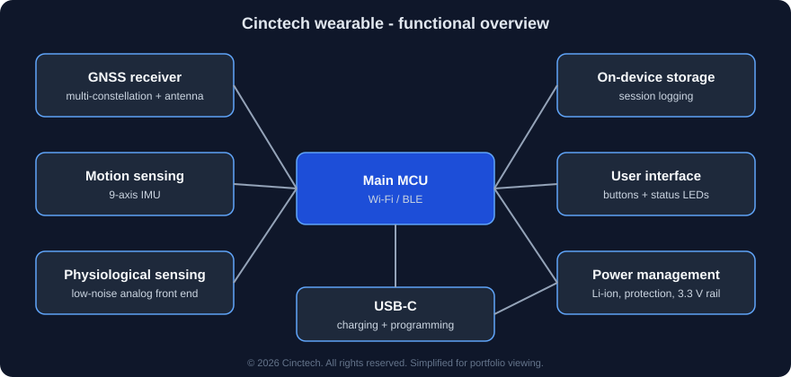
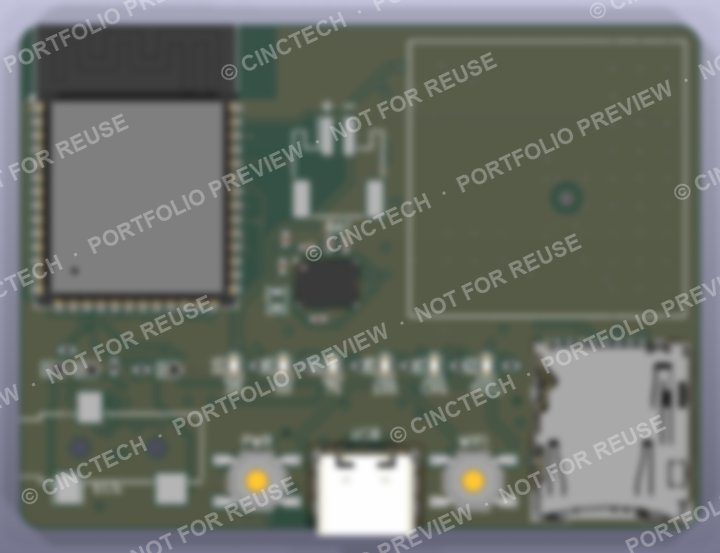
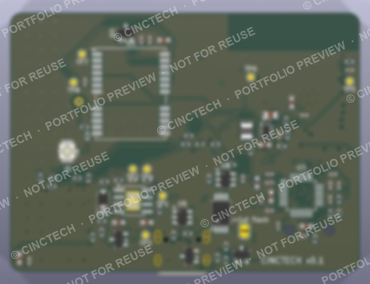

# Cinctech — Wearable Hardware (Portfolio Showcase)

> **Cinctech** is a hardware startup building a **low-cost, high-accuracy wearable that tracks football players' movement and performance**.
> This repository is a **portfolio overview** of the hardware I designed as Founding Member & Hardware Engineer.
> Design files are **not public**. See [What is not in this repo](#what-is-not-in-this-repo).

## At a glance

| | |
|---|---|
| **Board** | 4-layer PCB, **62 × 46 mm** (slightly larger than a matchbox), components on both sides |
| **Complexity** | **120+ components**, ~50 unique parts, fine-pitch ICs at 0.5 mm pitch and 0402 passives |
| **Sensing** | Multi-constellation **GNSS**, **9-axis IMU**, low-noise **physiological sensing** front end |
| **Connectivity** | **Wi-Fi / BLE** microcontroller, USB-C (charging + programming) |
| **Power** | Single-cell **Li-ion** with charging, battery protection, USB/battery load-sharing, **buck-boost 3.3 V** rail, firmware-controlled soft power switch |
| **Storage & UI** | On-device session logging, buttons, battery/charge status LEDs |
| **Verification** | **0 ERC errors, 0 DRC errors, 0 unconnected nets, 0 schematic/PCB mismatches** |
| **Status** | Mark 2 prototype in fabrication; Mark 3 (cost-optimised) in planning |

## Board previews

| Top | Bottom |
|---|---|
|  |  |

*Renders are intentionally low-resolution and watermarked.*

## My role

- **Hardware architecture**: chose the sensing, compute, storage and power blocks and how they connect.
- **Schematic design**: every sub-circuit checked line by line against its manufacturer datasheet (reference circuits, strapping/boot pins, decoupling, protection).
- **PCB layout**: 4-layer stack-up, double-sided placement, RF and noise-aware floor-planning, routing and DRC closure.
- **Manufacturing preparation**: fabrication and assembly outputs, BOM with exact manufacturer part numbers, vendor benchmarking (4+ PCB manufacturers).
- **Cost engineering**: unit-economics model across production volumes; identified a cost-down path of roughly **50% on the BOM** for the next revision.

## Design highlights

- **RF done properly**: 50 Ω controlled-impedance feed line over an unbroken ground plane, a ground-via fence, and keep-out zones so no other signal runs near the antenna path.
- **Noise isolation**: switching regulator, digital and RF sections placed apart, with a filtered supply for the sensitive analog front end.
- **Robust power path**: protection against over-charge, over-discharge and short circuit; the device runs while charging; firmware-managed low-power modes.
- **Designed for manufacture**: all parts verified against footprints, assembly drawings for every designator, both automated and hand assembly supported.

More detail: [docs/design-notes.md](docs/design-notes.md)

## Tools

KiCad 9 · Freerouting · Python (custom scripts for netlist, datasheet-rule and DRC checks, and output generation) · AI-assisted design tools for schematic capture, datasheet cross-checking and placement/routing, with every result reviewed and verified by me

## What is not in this repo

To protect the product, the following are **intentionally kept private**:
- schematics, PCB layout, Gerber/manufacturing files and the bill of materials
- exact component choices and supplier pricing
- firmware and the product's core algorithms and features

Recruiters or collaborators who need more detail can contact me through my GitHub profile; a deeper walkthrough can be arranged under NDA.

---

**© 2026 Cinctech. All rights reserved.**
This repository is shared for **portfolio viewing only**. No licence is granted to copy, modify, distribute or manufacture any part of this work.
